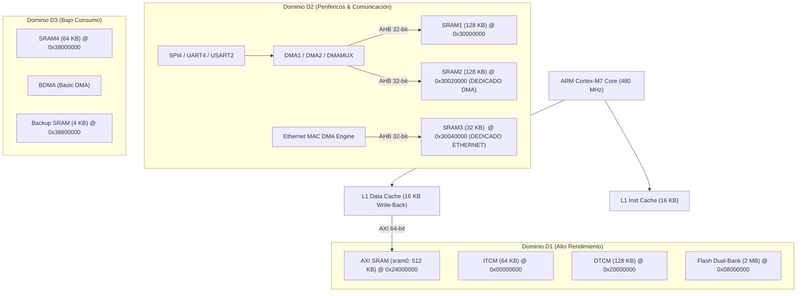
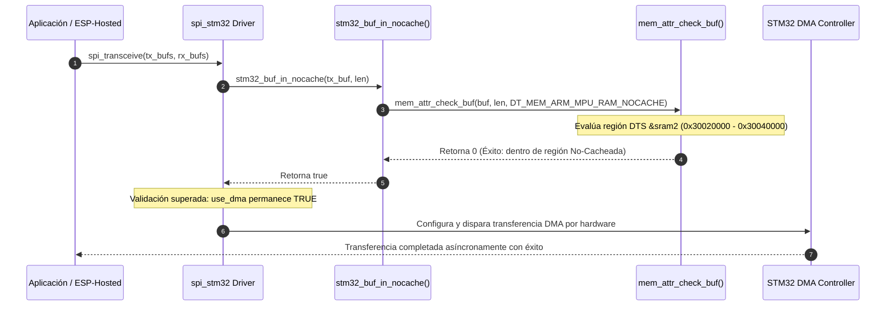

# Arquitectura de MPU, DMA y Coherencia de Caché L1 en STM32H7 (Zephyr RTOS)
**Plataforma de Hardware:** DAECGE BrightC-B1 BaseBoard V3  
**Microcontrolador:** STM32H743ZIT6 (ARM Cortex-M7 @ 480 MHz, LQFP144)  
**Entorno de Firmware:** Zephyr RTOS v4.x (Árbol Out-of-Tree)  
**Fecha:** Octubre 2026  
**Documento Técnico:** ARQ-MEM-001-REV1.0

---

## 1. Introducción y Contexto del Hardware

### 1.1 Plataforma BrightC-B1 BaseBoard V3
La plataforma **DAECGE BrightC-B1 BaseBoard V3** es un sistema embebido industrial para supervisión, telemetría y control distribuido. En su núcleo opera el microcontrolador de ultra-alto rendimiento **STM32H743ZIT6** de STMicroelectronics, basado en la arquitectura **ARM Cortex-M7** con pipeline superescalar de doble emisión, frecuencia de reloj de hasta 480 MHz, 2 MB de memoria Flash de doble banco y 1 MB de memoria SRAM heterogénea distribuida.

La placa integra una topología compleja de periféricos que comparten tráfico masivo y concurrente de datos hacia y desde la memoria interna:

```
                                  +---------------------------------------+
                                  |     STM32H743ZIT6 (Cortex-M7)         |
                                  |              480 MHz                  |
                                  |  +---------------------------------+  |
                                  |  | D-Cache L1 (16 KB) / I-Cache L1 |  |
                                  |  +---------------------------------+  |
                                  +---------------------------------------+
                                        |                   |
                     AXI 64-bit Bus     |                   |  AHB 32-bit Bus
                                        v                   v
+--------------------------+    +---------------+   +-------------------+    +----------------------+
| ESP32-WROOM-32 (Wi-Fi)   |--->| SPI4 + UART4  |   | LAN8742A (RMII)   |--->| Ethernet MAC 10/100  |
| ESP-Hosted-MCU Protocol  |    | DMA (Stream)  |   | 50 MHz Ref Clock  |    | Dedicated DMA Engine |
+--------------------------+    +---------------+   +-------------------+    +----------------------+
                                        |                   |
                                        +---------+---------+
                                                  |
                                                  v
                                      +-----------------------+
                                      |     Matriz de Bus     |
                                      |   D1 / D2 / D3 SRAM   |
                                      +-----------------------+
                                                  |
                               +------------------+------------------+
                               |                                     |
                               v                                     v
                 +---------------------------+         +---------------------------+
                 | RS485 Puertos 1 y 2       |         | W25Q16 NOR Flash Externa  |
                 | USART2 / UART7 con DE     |         | Quad-SPI (Memory Mapped)  |
                 +---------------------------+         +---------------------------+
```

### 1.2 Periféricos Críticos Involucrados
1. **Wi-Fi Coprocessor (ESP32-WROOM-32 vía ESP-Hosted-MCU):**
   - **Enlace de datos primario:** Bus SPI4 de alta velocidad (PE11/NSS, PE12/SCK, PE13/MISO, PE14/MOSI) operando en modo maestro full-duplex con control por hardware de flujo mediante GPIOs auxiliares (Data Ready en PE15, Handshake en PD13 y Reset en PD14).
   - **Enlace de respaldo / control:** Interfaz UART4 (PD1/TX, PD0/RX) para configuración por comandos o fallback asíncrono.
   - Requiere transferencias DMA bidireccionales continuas de alta velocidad para transportar paquetes de red L2/L3 (802.11 / IPv4).
2. **Ethernet MAC 10/100 Mbps (LAN8742A):**
   - Conexión RMII física: Reloj de referencia 50 MHz en PA1, CRS_DV en PA7, RXD[0:1] en PC4/PC5, TX_EN en PG11, TXD[0:1] en PG13/PB13, y bus de gestión MDIO (PA2) / MDC (PC1) con reset en PG4.
   - El controlador STM32H7 Ethernet MAC integra su propio motor DMA dedicado mediante listas encadenadas de descriptores de transmisión y recepción.
3. **Comunicaciones Seriales Industriales (RS485):**
   - Transceptor RS485-1 en USART2 (PD5/TX, PD6/RX, PD4/DE) y RS485-2 en UART7/8, con requerimientos de transferencias en ráfaga asistidas por DMA.
4. **Almacenamiento Externo Quad-SPI:**
   - Memoria flash Winbond W25Q16 conectada al controlador Quad-SPI del MCU para almacenamiento de datos no volátiles y parámetros de calibración.

### 1.3 Documentación de Referencia del Hardware
- Proyecto CubeMX: `hardware/BrightC_ETH_CycloneTCP_FileX.ioc`
- Documento de pinctrl y asignaciones: `boards/daecge/brightc-controllerv3/doc/brightcV3.md`
- Esquemático funcional: `hardware/BRIGHT C V3 TOP.PDF`
- Hoja de datos: `hardware/DS_stm32h743vi.pdf` (STMicroelectronics DocID029041)

---

## 2. Arquitectura de Memoria del STM32H7 y Conflicto DMA vs D-Cache L1

### 2.1 Topología Multibus y Dominios de Energía
El STM32H743 divide su mapa de memoria y periféricos en tres dominios de energía independientes interconectados mediante una matriz de bus AXI de 64 bits y una matriz multibus AHB de 32 bits:



#### Resumen de las Regiones de SRAM en STM32H743:
| Región DTS | Dominio | Dirección Base | Tamaño | Matriz de Bus | Acceso DMA Directo | Uso Recomendado en Arquitectura |
| :--- | :--- | :--- | :--- | :--- | :--- | :--- |
| `itcm` | D1 | `0x00000000` | 64 KB | TCM (Ciclo 0) | NO (Sólo CPU) | ISRs críticas, bucles matemáticos de tiempo real |
| `dtcm` | D1 | `0x20000000` | 128 KB | TCM (Ciclo 0) | NO (DMA1/2 no acceden) | Stacks de tareas prioritarias, datos de latencia cero |
| `sram0` | D1 | `0x24000000` | 512 KB | AXI (64-bit) | SÍ (vía AXI-AHB bridge)| RAM principal de Zephyr (`zephyr,sram`), Heaps, Stacks |
| `sram1` | D2 | `0x30000000` | 128 KB | AHB (32-bit) | SÍ (DMA1, DMA2) | Buffers intermedios, Ring buffers de aplicación |
| `sram2` | D2 | `0x30020000` | 128 KB | AHB (32-bit) | SÍ (DMA1, DMA2) | **Buffers DMA No-Cacheados (SPI4 ESP-Hosted, UART4)** |
| `sram3` | D2 | `0x30040000` | 32 KB | AHB (32-bit) | SÍ (Ethernet MAC DMA) | **Buffers y Descriptores Ethernet MAC (LAN8742A)** |
| `sram4` | D3 | `0x38000000` | 64 KB | AHB (32-bit) | SÍ (Sólo BDMA) | Periféricos de bajo consumo (LPUART, SPI6, I2C4) |
| `backup_sram`| D3 | `0x38800000` | 4 KB | AHB (32-bit) | SÍ (BDMA) | Variables retenidas con batería VBAT |

### 2.2 El Problema Fundamental: Incoherencia entre DMA y D-Cache L1
El procesador Cortex-M7 cuenta con **16 KB de Data Cache (D-Cache)** con líneas de 32 bytes organizadas en política de reemplazo asociativa de 4 vías. Por defecto, cuando la caché está activada (`CONFIG_DCACHE=y`), el subsistema opera bajo una política **Write-Back / Write-Allocate**:

1. **Lectura con Caché:** Si la CPU solicita una dirección de memoria, se cargan 32 bytes continuos (una *Cache Line*) desde la SRAM hacia la D-Cache.
2. **Escritura con Write-Back:** Si la CPU escribe en esa dirección, el dato se actualiza en la línea de la D-Cache y la línea se marca como *Dirty* (sucia). La memoria física SRAM **no** se actualiza de inmediato; el volcado hacia la SRAM sólo ocurrirá cuando la línea sea desalojada por saturación o por una orden explícita de limpieza (*flush*).

Por otro lado, los controladores DMA (DMA1, DMA2, BDMA y el DMA Ethernet) son **maestros de bus autónomos de hardware** que acceden directamente a las matrices AXI/AHB y a la SRAM física:
- **Ausencia de Bus Snooping:** A diferencia de procesadores de servidores o núcleos de aplicaciones ARM Cortex-A multinúcleo con interfaces CCI/ACE, el ARM Cortex-M7 **no posee una unidad de monitoreo de bus (Snoop Control Unit)** para sincronizar la caché L1 con las transacciones maestras de periféricos externos.
- Si un buffer reside en memoria cacheada ordinaria (como `sram0` en `0x24000000`), se producen dos fallas fatales:

#### Escenario 1: Transmisión DMA Corrupta (TX Incoherence)
```
1. CPU ejecuta: buffer_tx[0] = 0xAA; buffer_tx[1] = 0xBB;
2. D-Cache almacena: [0xAA, 0xBB] (Línea marcada como DIRTY en L1).
3. SRAM física todavía contiene: [0x00, 0x00] (datos viejos o basura).
4. El driver inicia la transferencia DMA hacia SPI4.
5. El controlador DMA lee directamente la SRAM física.
   -> RESULTADO: El DMA transmite [0x00, 0x00]. ¡Pérdida/corrupción de datos!
```

#### Escenario 2: Recepción DMA Invalida (RX Incoherence)
```
1. El periférico SPI4 recibe una trama de red del ESP32.
2. El DMA escribe la trama [0xDE, 0xAD, 0xBE, 0xEF] directamente en la SRAM física.
3. La CPU previamente leyó una variable cercana y la D-Cache retuvo la copia vieja [0x00, 0x00, 0x00, 0x00].
4. La CPU ejecuta una lectura de buffer_rx[0].
5. El núcleo Cortex-M7 responde inmediatamente desde la D-Cache L1 (Cache Hit).
   -> RESULTADO: La CPU lee datos obsoletos ignorando lo recibido por el DMA.
```

#### Escenario 3: Destrucción por Falso Compartido (False Sharing Hazard)
Si el buffer DMA no está perfectamente alineado a un múltiplo de **32 bytes** (tamaño de la Cache Line) o si su tamaño no es múltiplo de 32 bytes, variables locales adyacentes de la aplicación compartirán la misma línea de caché:
- Si el software invalida la línea de caché para ver los datos del DMA, **destruye las escrituras pendientes** de las variables adyacentes no guardadas aún en SRAM.
- Si la CPU hace un flush de una variable vecina, sobreescribe con datos viejos los bytes que el DMA acababa de depositar en la SRAM.

### 2.3 Bloqueo Preventivo en Zephyr RTOS (`spi_stm32`)
Para evitar corrupciones silenciosas de memoria, el subsistema de SPI de Zephyr para STM32 (`zephyr/drivers/spi/spi_stm32.c`) contiene una verificación de integridad de caché en tiempo de ejecución:

```c
#if defined(CONFIG_DCACHE) && defined(CONFIG_SPI_STM32_DMA) && !defined(CONFIG_SPI_RTIO)
	if (use_dma &&
	    ((tx_bufs != NULL && !spi_buf_set_in_nocache(tx_bufs)) ||
	     (rx_bufs != NULL && !spi_buf_set_in_nocache(rx_bufs)))) {
		LOG_WRN_ONCE("SPI DMA transfers not supported on cached memory.");
		if (IS_ENABLED(CONFIG_SPI_STM32_INTERRUPT)) {
			LOG_WRN_ONCE("Falling back to interrupt mode.");
		} else {
			LOG_WRN_ONCE("Falling back to polling mode.");
		}
		use_dma = false;
	}
#endif
```

Si los buffers de transmisión y recepción no están formalmente reconocidos como **No-Cacheados** por el kernel (`stm32_buf_in_nocache()` retorna `false`), el driver desactiva el DMA y degrada la comunicación al modo polling/interrupción. En un stack de alto rendimiento como `espressif,esp-hosted-mcu` a 5-20 MHz de reloj SPI, esto colapsa la CPU al 100% de uso y genera *buffer overruns* masivos.

---

## 3. El Rol de la MPU (Memory Protection Unit) en ARMv7-M

La **MPU (Memory Protection Unit)** de la arquitectura ARMv7-M es el bloque de hardware responsable de definir atributos de acceso (privilegios de ejecución, permisos de lectura/escritura) y políticas de caché (Cacheable, Non-Cacheable, Write-Through, Write-Back, Shareable) para regiones específicas del espacio de direccionamiento de 4 GB.

### 3.1 Requisitos Estrictos de Región en ARMv7-M
A diferencia de ARMv8-M (donde las regiones MPU se definen mediante direcciones de inicio y fin arbitrarias alineadas a 32 bytes), **ARMv7-M (Cortex-M7) impone dos reglas matemáticas inmutables:**

1. **Tamaño Potencia de Dos:** El tamaño de toda región de la MPU debe ser estrictamente igual a:
   $$\text{Size} = 2^N \quad \text{donde } 5 \le N \le 32 \quad (32\text{ bytes} \le \text{Size} \le 4\text{ GB})$$
2. **Alineación Natural a la Base:** La dirección física base de la región debe ser un múltiplo entero exacto de su tamaño:
   $$\text{Base Address} \pmod{\text{Size}} = 0$$

*Ejemplo:* Una región de 128 KB (`0x20000` bytes) sólo puede ubicarse en direcciones que terminen en `0x00000`, `0x20000`, `0x40000`, etc. La región **SRAM2** del STM32H7 está ubicada en `0x30020000` con un tamaño de exactamente 128 KB ($2^{17}$ bytes):
$$0x30020000 \pmod{0x20000} = 0 \quad \checkmark \text{ (Cumple 100\% con el hardware MPU)}$$

### 3.2 Atributos de Región en el Registro `MPU_RASR`
Para buffers DMA, la MPU debe configurarse con los siguientes campos de atributos:
- **`NORMAL_OUTER_INNER_NON_CACHEABLE` (`TEX=001, C=0, B=0`):** La memoria se clasifica como *Normal Memory* (permite accesos no alineados y transferencias en ráfaga AXI/AHB optimizadas) pero **desactiva por completo la caché de datos e instrucciones**. La CPU lee y escribe siempre directamente sobre la SRAM física.
- **`SHAREABLE` (`S = 1`):** Informa a la matriz de interconexión que la memoria es compartida entre múltiples maestros de bus (Cortex-M7 Core, DMA1, DMA2), forzando el orden determinista de las transacciones de bus.
- **`EXECUTE_NEVER` (`XN = 1`):** Bloquea la búsqueda o ejecución especulativa de código desde esta región, previniendo excepciones graves de bus (`RDSERR`) y protegiendo el sistema contra ataques de ejecución de código en buffers de datos.

### 3.3 Prioridad de Regiones Superpuestas (Region Nesting)
La MPU de ARMv7-M dispone de 16 regiones (índices del 0 al 15). Cuando dos regiones activas cubren la misma dirección de memoria:
$$\text{Prioridad}(\text{Región } j) > \text{Prioridad}(\text{Región } i) \iff j > i$$
La región con el **índice numérico más alto sobreescribe** las propiedades de la región de índice inferior. Esto permite declarar una región base amplia (por ejemplo, toda la RAM como Write-Back Cacheable en el índice 1) y colocar una ventana de exclusión No-Cacheada más pequeña en un índice superior (por ejemplo, índice 2 o superior).

---

## 4. Análisis de las 4 Opciones de Integración DMA + Caché en Zephyr RTOS

| Criterio | Opción 1: Región Dedicada No-Cacheada en DT | Opción 2: Sección Dinámica `__nocache` | Opción 3: Mantenimiento Explícito por Software | Opción 4: SRAM en Modo Write-Through |
| :--- | :--- | :--- | :--- | :--- |
| **Símbolo / Mecanismo** | `zephyr,memory-attr = <DT_MEM_ARM_MPU_RAM_NOCACHE>;` | `CONFIG_NOCACHE_MEMORY=y` | `sys_cache_data_flush_range()` `sys_cache_data_invd_range()` | `CONFIG_ARM_MPU_SRAM_WRITE_THROUGH=y` |
| **Sobrecarga de CPU** | **0% (Cero ciclos de CPU)** | 0% (Cero ciclos de CPU) | Alta (bucle de flush/invalidación por cada paquete) | Media-Alta (cada `STR` penaliza el pipeline de 480 MHz) |
| **Riesgo de Falso Compartido**| **Inexistente** (región física separada) | Posible si la sección se fragmenta | **Muy Alto** (corrupción de variables adyacentes) | N/A para TX, **Crítico para RX** |
| **Resolución de RX Incoherence**| **SÍ** (Lectura directa de SRAM) | **SÍ** (Lectura directa de SRAM) | **SÍ** (requiere invalidate explícito) | **NO** (Write-Through no invalida la D-Cache en RX) |
| **Alineación Hardware MPU** | **Perfecta** (SRAM2 es $2^{17}$ en base natural) | Compleja (el linker debe redondear a potencia de 2) | No usa MPU (depende de alineación manual a 32 B) | Afecta a toda la SRAM |
| **Soporte Out-of-the-Box** | **Nativo en Zephyr v3.6+ / v4.x** (`mem_attr`) | Requiere soporte en linker script de arquitectura | Requiere parchear o rehacer drivers que no lo usen | Soporte genérico en Zephyr |
| **Veredicto** | **SELECCIONADA** | Descartada por fragmentación y riesgo AXI | Descartada por overhead y soporte incompleto | Descartada (inviable para RX DMA) |

### 4.1 Análisis Detallado de Cada Alternativa

#### Opción 1: Región Dedicada No-Cacheada en Devicetree (Seleccionada)
Consiste en tomar una porción de SRAM física desacoplada (como `sram2`, 128 KB en el Dominio D2) y marcarla explícitamente en el Devicetree con el atributo `DT_MEM_ARM_MPU_RAM_NOCACHE`.
- **Por qué gana:** En el STM32H7, la topología de memoria ya está físicamente segmentada en dominios (D1, D2, D3). `sram2` tiene un tamaño exacto de 128 KB ($2^{17}$) y una dirección base natural `0x30020000`, satisfaciendo los requisitos de hardware de la MPU de ARMv7-M sin desperdiciar un solo byte. Al ser no-cacheada a nivel de hardware, ni la CPU ni el DMA sufren penalizaciones de software.

#### Opción 2: Sección Linker Dinámica `__nocache` (`CONFIG_NOCACHE_MEMORY=y`)
Genera un bloque en la sección de enlace (`_nocache_ram_start` a `_nocache_ram_end`).
- **Problema en Cortex-M7:** Para que la MPU de ARMv7-M proteja este bloque, el tamaño de la sección generada por el linker debe ser forzado a una potencia de 2 mediante padding artificial. Si la aplicación declara 10 KB de buffers, el linker debe reservar 16 KB; si declara 33 KB, debe saltar a 64 KB, generando fragmentación interna masiva. Además, si se ubica en el dominio AXI (`sram0`), los periféricos del dominio D2 y D3 sufren cuellos de botella por el puente AXI-to-AHB.

#### Opción 3: Mantenimiento Explícito de Caché por Software
La memoria se mantiene cacheada y el software ejecuta:
```c
/* Antes de transmitir por DMA: */
sys_cache_data_flush_range((void *)tx_buf, len);
/* Después de recibir por DMA: */
sys_cache_data_invd_range((void *)rx_buf, len);
```
- **Problema:** En transferencias pequeñas o de alta cadencia (por ejemplo, tramas SPI interactivas de 64 bytes a 10 Mbps), el costo de emitir instrucciones de limpieza de caché en bucle supera el tiempo de transferencia del hardware. Adicionalmente, el driver upstream `spi_stm32.c` **no** realiza mantenimiento de caché línea a línea para transferencias genéricas y rechaza la ejecución si el buffer no está en memoria física no-cacheada.

#### Opción 4: Región SRAM en Modo Write-Through (`CONFIG_ARM_MPU_SRAM_WRITE_THROUGH=y`)
Modifica el atributo de toda la SRAM principal a *Write-Through*. Cada vez que la CPU escribe, el dato se actualiza en la caché y en la SRAM en el mismo ciclo de instrucción.
- **Problema Fatal:** Resuelve la transmisión (TX), pero **no resuelve la recepción (RX)**. Cuando el DMA escribe una trama recibida desde Ethernet o Wi-Fi en la SRAM física, la línea de la D-Cache del Cortex-M7 no se entera y sigue reteniendo los datos antiguos. Para que RX funcione, se requerirían invalidaciones manuales continuas, anulando el beneficio. Además, escribir directamente en memoria externa/interna sin buffer de escritura satura el bus AXI a 480 MHz, reduciendo el rendimiento de cómputo del procesador hasta en un 40%.

---

## 5. Detalle de la Implementación Seleccionada (Opción 1)

### 5.1 Configuración en Devicetree para STM32H743
En el árbol de dispositivos de la placa (`boards/daecge/brightc-controllerv3/brightc-controllerv3.dts`), se configura el nodo `&sram2` importando las constantes oficiales de atributos de memoria:

```dts
#include <zephyr/dt-bindings/memory-attr/memory-attr-arm.h>

/ {
    /* La RAM principal del sistema permanece en sram0 (AXI SRAM, 512 KB, D1) */
    chosen {
        zephyr,sram = &sram0;
        zephyr,flash = &flash0;
        zephyr,console = &uart1;
        zephyr,shell-uart = &uart1;
    };
};

/* Configuración de SRAM2 como región No-Cacheada dedicada a DMA de periféricos */
&sram2 {
    compatible = "zephyr,memory-region", "mmio-sram";
    reg = <0x30020000 DT_SIZE_K(128)>;
    zephyr,memory-region = "SRAM2";
    zephyr,memory-attr = <DT_MEM_ARM_MPU_RAM_NOCACHE>;
    #memory-region-cells = <0>;
    status = "okay";
};
```

### 5.2 Coexistencia Aislada con el Subsistema Ethernet
Un punto crítico de la arquitectura es garantizar que el subsistema Ethernet y el subsistema Wi-Fi/Serial no colisionen por recursos de memoria DMA en el Dominio D2:

1. **Ethernet MAC y `sram3`:**
   En `zephyr/dts/arm/st/h7/stm32h743.dtsi`, el nodo Ethernet está ligado nativamente a `sram3`:
   ```dts
   ethernet@40028000 {
       memory-regions = <&sram3>;
   };
   ```
   El archivo de configuración de MPU del SoC (`zephyr/soc/st/stm32/stm32h7x/mpu_regions.c`) extrae este puntero y crea automáticamente dos regiones MPU dedicadas:
   - **`SRAM_ETH_BUF`:** Ubicada en `0x30040000` con un tamaño de 16 KB protegida con atributos `REGION_RAM_NOCACHE_ATTR`.
   - **`SRAM_ETH_DESC`:** Ubicada en `0x30040000` cubriendo los primeros 256 bytes con atributos de puerto de periféricos para los descriptores de DMA de hardware de la MAC.
2. **Independencia de `sram2`:**
   Al asignar `sram2` (`0x30020000`, 128 KB) para periféricos de comunicación general, **el controlador Ethernet opera de forma 100% aislada en `sram3`**. Ningún descriptor ni buffer de red Ethernet comparte el espacio de direcciones de los buffers de ESP-Hosted SPI4 ni de las UARTs, eliminando cualquier posibilidad de corrupción cruzada, fragmentación o inanición de memoria.

```
+-------------------------------------------------------------------------+
|                  Dominio D2: Mapa Físico de Memoria AHB                 |
+-------------------------------------------------------------------------+
| Dirección Base | Tamaño | Nodo DTS | Asignación Arquitectural           |
+----------------+--------+----------+------------------------------------+
|   0x30000000   | 128 KB |  sram1   | Buffers generales / App Auxiliar   |
+----------------+--------+----------+------------------------------------+
|   0x30020000   | 128 KB |  sram2   | BUFFER POOL DMA NO-CACHEADO        |
|                |        |          | (SPI4 Wi-Fi ESP-Hosted, UART4 DMA) |
+----------------+--------+----------+------------------------------------+
|   0x30040000   |  16 KB |  sram3   | ETHERNET MAC TX/RX PACKET BUFFERS  |
|   0x30044000   |  16 KB |  sram3   | ETHERNET MAC DMA DESCRIPTORS       |
+----------------+--------+----------+------------------------------------+
```

### 5.3 Declaración de Buffers en Código C de Aplicación o Drivers
Para colocar un buffer en la región no-cacheada `sram2`, se utilizan las macros estándar de integración con el linker de Zephyr:

```c
#include <zephyr/kernel.h>
#include <zephyr/linker/devicetree_regions.h>

/**
 * @brief Buffer de transmisión DMA para interfaz SPI4 (ESP-Hosted).
 * 
 * Se ubica en la sección de enlace generada a partir del nodo DT '&sram2'.
 * La alineación estricta a 32 bytes garantiza optimización en las ráfagas
 * del controlador DMA y concordancia con el tamaño de línea de bus.
 */
static uint8_t wifi_spi_tx_buf[2048]
    __attribute__((section(LINKER_DT_NODE_REGION_NAME(DT_NODELABEL(sram2)))))
    __aligned(32);

static uint8_t wifi_spi_rx_buf[2048]
    __attribute__((section(LINKER_DT_NODE_REGION_NAME(DT_NODELABEL(sram2)))))
    __aligned(32);
```

#### Reglas de Declaración:
1. **Macro `LINKER_DT_NODE_REGION_NAME(DT_NODELABEL(sram2))`:** Resuelve en tiempo de compilación el nombre exacto de la sección del enlazador (típicamente `.sram2_data` o `.SRAM2`).
2. **Atributo `__aligned(32)`:** Aunque la región sea no-cacheada, los maestros DMA del STM32H7 aprovechan las ráfagas de bus AXI/AHB (*burst transfers* de 4 u 8 palabras de 32 bits). Mantener la alineación a 32 bytes previene que las transferencias crucen límites de ráfaga y evita penalizaciones de rendimiento en los buses.

### 5.4 Validación Interna en Zephyr: Flujo de Ejecución de `stm32_cache.c`
Cuando el driver `spi_stm32` o cualquier periférico STM32 recibe una solicitud de transferencia DMA, valida la validez del puntero con la función central `stm32_buf_in_nocache()` implementada en `zephyr/soc/st/stm32/common/stm32_cache.c`:

```c
bool stm32_buf_in_nocache(uintptr_t buf, size_t len_bytes)
{
    uintptr_t buf_end;

    if (u32_add_overflow(buf, len_bytes - 1, (uint32_t *)&buf_end)) {
        return false;
    }

#ifdef CONFIG_NOCACHE_MEMORY
    if ((uintptr_t)_nocache_ram_start <= buf && buf_end <= (uintptr_t)_nocache_ram_end) {
        return true;
    }
#endif

#ifdef CONFIG_MEM_ATTR
    /* Verificación central del Devicetree: */
    if (mem_attr_check_buf((void *)buf, len_bytes, DT_MEM_ARM_MPU_RAM_NOCACHE) == 0) {
        return true;
    }
#endif

    if ((uintptr_t)__rodata_region_start <= buf && buf_end <= (uintptr_t)__rodata_region_end) {
        return true;
    }

    return false;
}
```



Si la región no contara con el atributo de Devicetree `zephyr,memory-attr = <DT_MEM_ARM_MPU_RAM_NOCACHE>`, `mem_attr_check_buf()` retornaría `-EINVAL`, la función retornaría `false`, y el driver caería en modo polling emitiendo la advertencia de fallo en la consola.

---

## 6. Guía Paso a Paso para Nuevas Implementaciones y Migración

Para asegurar la robustez de futuras integraciones (por ejemplo, habilitar DMA en USART2 para RS485, en SPI1 para pantallas o en SDMMC para almacenamiento masivo), se debe seguir este procedimiento de ingeniería.

### 6.1 Lista de Verificación (Checklist) para Habilitar DMA en Cualquier Periférico

#### Paso 1: Verificación de Matriz de Bus y Dominio
- Consultar la tabla de interconexión del STM32H7 para verificar qué controladores DMA pueden comunicarse con el periférico:
  - **DMA1 / DMA2:** Tienen acceso directo al Dominio D2 (SRAM1, SRAM2, SRAM3) y a los periféricos conectados a los buses APB1, APB2, APB4, AHB1, AHB2.
  - **BDMA:** Es el único DMA capaz de acceder al Dominio D3 (SRAM4) y a los periféricos en APB4/AHB4.
  - *Regla de Oro:* Los buffers de DMA1/DMA2 deben ubicarse en `sram1` o `sram2`. Nunca ubicarlos en DTCM (`0x20000000`), ya que DMA1 y DMA2 no pueden acceder a los buses TCM privados del Cortex-M7.

#### Paso 2: Configuración en Devicetree del Periférico
- Asociar los canales de DMA mediante el multiplexor **DMAMUX1** en el overlay o DTS de la placa:
  ```dts
  &usart2 {
      pinctrl-0 = <&usart2_tx_pd5 &usart2_rx_pd6>;
      pinctrl-names = "default";
      current-speed = <115200>;
      status = "okay";

      /* Configuración de canales DMAMUX para USART2 */
      dmas = <&dmamux1 43 0x400 0x3>,   /* DMAMUX1 Request 43: USART2_RX */
             <&dmamux1 44 0x400 0x3>;   /* DMAMUX1 Request 44: USART2_TX */
      dma-names = "rx", "tx";
  };
  ```

#### Paso 3: Ubicación de Buffers en Código C
- Todos los buffers de transferencia asignados al periférico **deben** ubicarse en `sram2`:
  ```c
  #include <zephyr/linker/devicetree_regions.h>

  static uint8_t usart2_dma_rx_buf[512]
      __attribute__((section(LINKER_DT_NODE_REGION_NAME(DT_NODELABEL(sram2)))))
      __aligned(32);
  ```

#### Paso 4: Configuración de Kconfig (`prj.conf`)
- Verificar que las siguientes opciones estén presentes en el archivo de configuración:
  ```ini
  # Habilitación de Caché de Datos
  CONFIG_DCACHE=y

  # Habilitación del subsistema de atributos de memoria
  CONFIG_MEM_ATTR=y

  # Soporte de controladores DMA y periféricos específicos
  CONFIG_DMA=y
  CONFIG_DMA_STM32=y
  CONFIG_DMAMUX_STM32=y
  CONFIG_SERIAL=y
  CONFIG_UART_ASYNC_API=y
  CONFIG_UART_STM32_DMA=y
  ```

#### Paso 5: Validación en Runtime
- Compilar la aplicación y verificar los logs durante el arranque:
  1. Confirmar que **no aparezcan** mensajes de degradación:
     `SPI DMA transfers not supported on cached memory. Falling back to polling mode.`
  2. Verificar la asignación de memoria inspeccionando el mapa de símbolos:
     ```bash
     arm-none-eabi-objdump -h build/zephyr/zephyr.elf | grep sram2
     ```
     La sección debe mostrar que `wifi_spi_tx_buf` o los buffers declarados residen estrictamente en el rango `[0x30020000 - 0x3003FFFF]`.

### 6.2 Integridad del Upstream de Zephyr
Es un requisito arquitectural fundamental que el repositorio del kernel Zephyr (`zephyr/`) **se mantenga estrictamente idéntico al upstream original sin aplicar modificaciones locales ni parches temporales**:
- **Toda la configuración de hardware reside en la placa:** La definición de `sram2`, los pines de periféricos y los enlaces DMAMUX deben existir exclusivamente en `boards/daecge/brightc-controllerv3/`.
- **Toda la configuración funcional reside en la aplicación:** Flags de optimización, buffers de sockets, tamaño de workqueues y prioridades residen en `app/prj.conf`.
- **Cumplimiento de la Clean Architecture:** El código de dominio de negocio y servicios nunca debe hacer mención a registros del STM32 ni a macros de hardware del fabricante. La gestión de buffers DMA se aísla por completo en la capa de infraestructura y adaptadores del sistema embebido.

---

## 7. Glosario y Resumen Arquitectural

- **AXI (Advanced eXtensible Interface):** Bus de datos de 64 bits de alta velocidad que conecta la CPU Cortex-M7 con la AXI SRAM (512 KB) y la Flash.
- **AHB (Advanced High-performance Bus):** Bus de interconexión para periféricos de comunicación y las SRAMs de los dominios D2 y D3.
- **Cache Line:** Bloque básico de transferencia de la D-Cache L1 (32 bytes en Cortex-M7).
- **DMAMUX:** Conmutador matricial del STM32H7 que permite enrutar cualquier solicitud de periférico hacia cualquier canal de DMA1 o DMA2.
- **MPU (Memory Protection Unit):** Módulo de hardware ARM que define el comportamiento y seguridad de las regiones de memoria.
- **Write-Back:** Política de caché donde las modificaciones se guardan en la L1 y sólo se escriben en la RAM física cuando la línea se desaloja o se fuerza por software.
- **Non-Cacheable:** Región de memoria donde la CPU elude la caché L1 y realiza accesos de lectura y escritura directamente contra la memoria física, garantizando coherencia instantánea con los maestros DMA.
