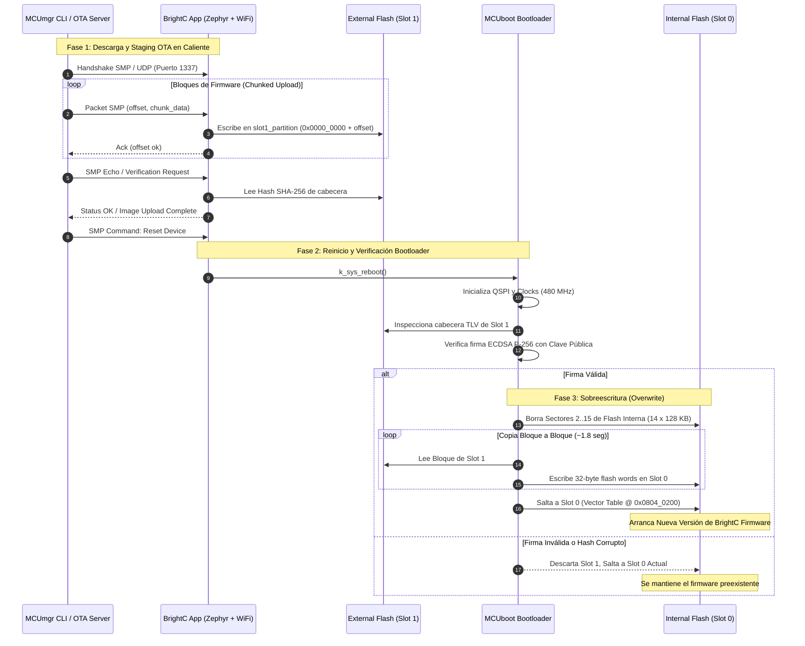

# Arquitectura de Actualización de Firmware OTA con MCUboot y Flash Externa QSPI
## BrightC Controller V3 — STM32H743ZIT6 + Winbond W25Q16

- **Autor:** Principal Embedded Software Architect
- **Proyecto:** BrightC Controller V3 Firmware
- **Estado:** Propuesta de Arquitectura Aprobada
- **Fecha:** Octubre 2026
- **Target MCU:** STMicroelectronics STM32H743ZIT6 (ARM Cortex-M7 @ 480 MHz)
- **Target External Flash:** Winbond W25Q16JV (16 Mbit / 2 MBytes NOR Flash, Quad-SPI)
- **RTOS / Toolchain:** Zephyr RTOS v4.x + Sysbuild + MCUboot v2.x + MCUmgr SMP

---

## 1. Resumen Ejecutivo y Decisión Arquitectónica

El controlador industrial **BrightC Controller V3** requiere un mecanismo robusto, seguro y de alta disponibilidad para la actualización de firmware en campo (*Over-The-Air*, OTA). El dispositivo integra conectividad Wi-Fi y Bluetooth mediante un coprocesador Espressif ESP32 conectado vía bus SPI4 de alta velocidad (`esp-hosted-mcu`), una pila de red completa TCP/IPv4, consola Shell interactiva, interfaces RS485 Modbus, buses SPI para 32 I/O de expansión industrial, 15 canales ADC calibrados, e interfaz visual para pantalla DWIN.

### Especificaciones del Hardware Core
| Subsistema | Componente | Características Principales |
| :--- | :--- | :--- |
| **Microcontrolador** | STM32H743ZIT6 | ARM Cortex-M7 con FPU DP @ 480 MHz, L1 I/D Cache (16 KB + 16 KB) |
| **Flash Interna** | Dual-Bank Flash | **2048 KiB (2 MB)** organizada en 2 bancos simétricos de 1024 KiB |
| **SRAM de Sistema** | 1024 KiB (1 MB) | DTCM (128 KB), AXI SRAM (512 KB), SRAM1-3 (288 KB), SRAM4 (64 KB) |
| **Memoria Externa** | Winbond W25Q16JV | **16 Mbit (2 MBytes)** NOR Flash conectada en bus QUADSPI (4-bit) @ 40 MHz |
| **Coprocesador RF** | ESP32-WROOM-32 | Wi-Fi 802.11 b/g/n + BLE 4.2 vía SPI4 (`esp-hosted-mcu`), dma-backed |

### Decisión Arquitectónica Principal
Se adopta una **Arquitectura de Particionado Asimétrico con Flash Externa para Staging OTA**:
1. **Slot 0 (Activo / XIP):** Ubicado en la Flash Interna del STM32H7 con un tamaño expandido de **1792 KiB (1.75 MB)**, permitiendo ejecución directa de código (*Execute-in-Place*) a 480 MHz con latencia cero a través de la interfaz ART Accelerator y L1 Caches.
2. **Slot 1 (Staging / Descarga OTA):** Ubicado en la Flash Externa Winbond W25Q16 vía QUADSPI con un tamaño idéntico de **1792 KiB (1.75 MB)**.
3. **Mecanismo de Actualización:** **MCUboot en modo Overwrite (`CONFIG_BOOT_UPGRADE_ONLY=y`)** con verificación asimétrica basada en firmas digitales **ECDSA P-256**.
4. **Transporte de Telemetría y Carga:** **MCUmgr SMP (Simple Management Protocol)** encapsulado sobre **UDP / Wi-Fi** y redundancia local sobre **Shell UART**.
5. **Orquestador de Construcción:** **Zephyr Sysbuild**, garantizando la compilación multi-imagen coordinada, la generación de firmas criptográficas automáticas y el empaquetado de artefactos listos para producción.

```
+===================================================================================+
|                              MAPA DE ALTO NIVEL OTA                               |
+===================================================================================+
|                                                                                   |
|  [ Servidor OTA / CLI mcumgr ]                                                    |
|               |                                                                   |
|       (Wi-Fi / UDP Port 1337 / SMP Protocol)                                      |
|               v                                                                   |
|  [ BrightC V3 Application ]                                                      |
|         |                                                                         |
|         +---> Escribe bloques SMP en Slot 1 (Memoria Externa W25Q16 QSPI)         |
|         |     Tamaño: 1792 KiB                                                    |
|         |                                                                         |
|         +---> Valida integridad y solicita k_sys_reboot()                         |
|               |                                                                   |
|               v                                                                   |
|  [ MCUboot Bootloader (Sector 0: 128 KiB Flash Interna) ]                        |
|         |                                                                         |
|         +---> 1. Lee cabecera TLV y verifica firma ECDSA P-256 con Clave Pública  |
|         +---> 2. Si es válida: Copia Slot 1 (QSPI) -> Slot 0 (Flash Interna)      |
|         +---> 3. Salta a ejecución XIP de Slot 0 @ 480 MHz                        |
|                                                                                   |
+===================================================================================+
```

---

## 2. Justificación Técnica

### 2.1 Diagnóstico del Estado Actual en `brightc-controllerv3.dts`
En la configuración devicetree heredada de `brightc-controllerv3.dts`, el mapa de memoria presentaba una subutilización severa:

```dts
/* Configuración heredada problemática */
boot_partition:    128 KB  (0x0000_0000 - 0x0001_FFFF)
storage_partition: 128 KB  (0x0002_0000 - 0x0003_FFFF)
slot0_partition:   256 KB  (0x0004_0000 - 0x0007_FFFF)  <-- ¡GRAVE LIMITACIÓN!
slot1_partition:   256 KB  (0x0008_0000 - 0x000B_FFFF)
scratch_partition: 128 KB  (0x000C_0000 - 0x000D_FFFF)
/* Fin de asignación: 896 KB. Flash interna no mapeada: 1152 KB */
```

#### Impacto Crítico:
1. **Estrangulamiento del Firmware:** La aplicación estaba limitada a **256 KiB**.
   - Con la pila de red Zephyr v4.x, Wi-Fi `esp-hosted-mcu`, stacks IPv4/DHCP/DNS/Sockets, logging, shell interactivo, 4 chips expansores MCP23S17 en SPI, y drivers ADC con DMA, la imagen actual compilada supera fácilmente los **350 KiB**, haciendo imposible compilar o agregar nuevas características (TLS, MQTT, lógica HVAC, UI DWIN).
2. **Desperdicio de Recursos:** Más de **1152 KiB (56.25%) de la memoria flash interna permanecían inutilizados**.
3. **Subutilización de la Flash Externa:** La memoria W25Q16 (2048 KiB) estaba reservada únicamente como partición de almacenamiento genérico (`ext-flash-storage`), ignorando su potencial como buffer masivo de staging OTA.

---

### 2.2 Comparativa de Opciones Arquitectónicas

Se evaluaron dos aproximaciones de diseño para resolver el particionado:

| Criterio | Opción A: Dual-Bank Interno Puro | Opción B: Particionado Asimétrico QSPI (Seleccionada) |
| :--- | :--- | :--- |
| **Ubicación Slot 0** | Flash Interna (Bank 1) | Flash Interna (Bank 1 + Bank 2) |
| **Ubicación Slot 1** | Flash Interna (Bank 2) | Flash Externa Winbond W25Q16 (QUADSPI) |
| **Tamaño Máximo App** | **768 KiB a 896 KiB** | **1792 KiB (1.75 MB)** |
| **Flash Interna Libre** | 0 KB (Completamente consumida por backup) | 0 KB (Aprovechada al 100% para la App activa) |
| **Uso de Flash Externa** | Solo almacenamiento de datos | Staging OTA (1792 KB) + Filesystem LittleFS (256 KB) |
| **Rendimiento XIP** | 480 MHz (Flash interna) | 480 MHz (Flash interna) |
| **Desgaste Flash Interna**| Alto (cada descarga borra y escribe el Bank 2) | Mínimo (la descarga OTA desgasta la flash externa SPI) |
| **Aislamiento en Descarga**| Potencial contención de bus durante borrado interno | Total aislamiento: la flash externa se borra vía QSPI DMA |
| **Capacidad de Expansión** | Restringida (techo de ~800 KB para siempre) | Máxima: 1.75 MB permite TLS, gráficos, MQTT, ML, WebServer |

### 2.3 Por qué la Opción B es la Solución Óptima para BrightC
1. **Headroom sin Compromisos:** Una aplicación de control industrial como BrightC requiere margen para librerías criptográficas mbedTLS (HTTPS/MQTTS), servidores web embebidos de diagnóstico, actualizaciones de firmware del coprocesador ESP32 mediante pasarela SMP, y buffers de telemetría. 1792 KiB asegura vida útil para los próximos 7 a 10 años.
2. **Protección de la Flash de Código:** Durante la recepción de paquetes por Wi-Fi (que puede ser inestable o interrumpirse), las operaciones de borrado y escritura ocurren exclusivamente en la memoria externa QSPI. La flash interna nunca se toca hasta que la imagen ha sido íntegramente recibida y validada criptográficamente en el arranque por MCUboot.
3. **Resiliencia Operativa:** La flash externa Winbond W25Q16 ofrece más de 100,000 ciclos de borrado/escritura por sector de 4 KB, absorbiendo todo el desgaste derivado de transferencias abortadas o pruebas continuas de CI/CD.

---

## 3. Análisis de Compatibilidad de Flash y Tamaño de Sectores

Uno de los mayores desafíos en el diseño de bootloaders para microcontroladores de alto rendimiento con memorias híbridas es la disparidad geométrica de las tecnologías de almacenamiento.

### 3.1 Características Físicas de las Memorias

#### A) Flash Interna STM32H743ZI (`flash0`)
- **Tecnología:** Flash embebida NOR con ECC (Error Correction Code).
- **Organización:** 2 Bancos de 1 MB cada uno (Total: 2048 KiB).
- **Geometría de Sectores:** Uniforme de **128 KiB (131,072 bytes)** por sector.
  - Banco 1: Sectores 0 al 7 (0x0800_0000 a 0x080F_FFFF).
  - Banco 2: Sectores 8 al 15 (0x0810_0000 a 0x081F_FFFF).
- **Granularidad de Escritura:** Flash word de **256 bits (32 bytes)** con 10 bits de ECC.
- **Restricción de Programación:** Una palabra de 32 bytes solo puede programarse una vez entre operaciones de borrado de sector. No se admiten escrituras parciales byte a byte.

#### B) Flash Externa Winbond W25Q16JV (`w25q16_qspi`)
- **Tecnología:** Serial NOR Flash Quad-SPI.
- **Organización:** 2,097,152 bytes (2 MBytes).
- **Geometría de Sectores:**
  - Sectores uniformes de **4 KiB (4,096 bytes)**.
  - Bloques de 32 KiB (8 sectores) y 64 KiB (16 sectores).
- **Granularidad de Escritura:** Página de **256 bytes**. Se permiten escrituras desde 1 hasta 256 bytes por ráfaga.

---

### 3.2 Demostración Matemática de Alineación por MCM

Para garantizar que una partición definida en la memoria externa pueda mapearse y copiarse sobre la memoria interna sin provocar escrituras desalineadas, corrupciones de ECC o sobreescritura de sectores adyacentes, la granularidad de la partición debe ser múltiplo del Mínimo Común Múltiplo (MCM) de los tamaños de borrado de ambas tecnologías:

$$\text{EraseSize}_{\text{Interna}} = 128\,\text{KiB} = 131,072\,\text{bytes}$$
$$\text{EraseSize}_{\text{Externa}} = 4\,\text{KiB} = 4,096\,\text{bytes}$$

$$\text{MCM}(128\,\text{KiB}, 4\,\text{KiB}) = 128\,\text{KiB}$$

#### Validación de la Ranura Seleccionada ($1792\,\text{KiB}$):
$$1792\,\text{KiB} = 1,835,008\,\text{bytes}$$

1. **En Flash Interna (STM32H7):**
   $$\frac{1792\,\text{KiB}}{128\,\text{KiB}} = 14.0\quad\text{(Exactamente 14 sectores completos de 128 KiB)}$$
   - Corresponde a los Sectores 2, 3, 4, 5, 6, 7 (Banco 1) y 8, 9, 10, 11, 12, 13, 14, 15 (Banco 2).
   - Fragmentación interna: **0 bytes**.

2. **En Flash Externa (W25Q16):**
   $$\frac{1792\,\text{KiB}}{4\,\text{KiB}} = 448.0\quad\text{(Exactamente 448 sectores de 4 KiB)}$$
   $$\frac{1792\,\text{KiB}}{64\,\text{KiB}} = 28.0\quad\text{(Exactamente 28 bloques de 64 KiB)}$$
   - Fragmentación externa: **0 bytes**.

3. **Espacio Remanente en Flash Externa:**
   $$2048\,\text{KiB} - 1792\,\text{KiB} = 256\,\text{KiB} = 64 \times 4\,\text{KiB}\quad\text{(Asignado a filesystem /lfs)}$$

---

### 3.3 Justificación de Modo Overwrite (`CONFIG_BOOT_UPGRADE_ONLY=y`)

MCUboot admite dos modos de actualización principales:
1. **Swap Mode (Intercambio):** Intercambia sector por sector las imágenes entre Slot 0 y Slot 1 para permitir rollback automático si la nueva imagen no se confirma (`boot_set_confirmed()`).
2. **Upgrade Only / Overwrite Mode (Sobreescritura directa):** Valida Slot 1 y lo copia unidireccionalmente sobre Slot 0.

#### ¿Por qué Swap Heterogéneo es Inviable y Peligroso en esta Arquitectura?
- **Disparidad de Sectores (128 KB vs 4 KB):** Para realizar swap entre sectores de distinto tamaño, MCUboot requiere emular un algoritmo de swap heterogéneo que necesita una partición scratch de al menos el tamaño del sector más grande (**128 KiB**) en la flash interna.
- **Riesgo por Fallo de Alimentación:** Durante un swap heterogéneo, un solo sector de 128 KB del STM32H7 debe intercambiarse con 32 sectores individuales de 4 KB de la flash externa mediante múltiples pasos intermedios de borrado y escritura de status en el scratch. Un corte de energía en este proceso conlleva un riesgo no despreciable de estados inconsistentes.
- **Tiempo de Swap Extremo:** El intercambio bidireccional duplica el número de operaciones de I/O sobre QSPI y flash interna, extendiendo el tiempo de arranque de actualización a más de 12 a 15 segundos.

#### Ventajas del Modo Overwrite Seleccionado:
1. **Verificación Previa Cero-Riesgo:** MCUboot no borra ningún sector de la flash interna hasta que la imagen en Slot 1 ha sido completamente verificada criptográficamente (verificación de firma digital ECDSA P-256 sobre hash SHA-256). Si la imagen está corrupta o la firma es inválida, Slot 0 permanece intacto y arranca inmediatamente.
2. **Velocidad de Actualización Sobresaliente:**
   - La flash externa se lee en modo Quad-SPI (4 líneas @ 40 MHz) a $\approx 18\,\text{MB/s}$.
   - El STM32H7 borra sus 14 sectores internos y programa palabras de 32 bytes a alta velocidad.
   - El tiempo total de sobreescritura de 1.5 MB se completa en aproximadamente **1.8 a 2.2 segundos**, minimizando el tiempo fuera de servicio (*downtime* del sistema industrial).
3. **Ahorro de Memoria:** No se requiere `scratch_partition`, liberando 128 KiB de flash interna para la aplicación o almacenamiento de calibración.

---

## 4. Mapa de Memoria y Particionado Devicetree

### 4.1 Distribución General de la Memoria

```
+===================================================================================+
|                        MAPA DE MEMORIA BRIGHTC CONTROLLER V3                      |
+===================================================================================+

 FLASH INTERNA STM32H743ZI (2048 KiB / 0x0800_0000 - 0x081F_FFFF)
+-------------------+-----------------+-------------+-------------------------------+
| Dirección Base    | Sector Físico   | Tamaño      | Etiqueta DTS / Propósito      |
+-------------------+-----------------+-------------+-------------------------------+
| 0x0800_0000       | Sector 0 (B1)   | 128 KiB     | `boot_partition` (MCUboot)    |
| 0x0802_0000       | Sector 1 (B1)   | 128 KiB     | `storage_partition` (NVS)     |
| 0x0804_0000       | Sectores 2..7   | 768 KiB     | `slot0_partition` (App Active)|
| 0x0810_0000       | Sectores 8..15  | 1024 KiB    |  (Continuación Slot 0 en B2)  |
|                   |                 | Total: 1792K|                               |
+-------------------+-----------------+-------------+-------------------------------+

 FLASH EXTERNA WINBOND W25Q16 QUADSPI (2048 KiB / 0x0000_0000 - 0x001F_FFFF)
+-------------------+-----------------+-------------+-------------------------------+
| Offset Relativo   | Bloques 64K     | Tamaño      | Etiqueta DTS / Propósito      |
+-------------------+-----------------+-------------+-------------------------------+
| 0x0000_0000       | Bloques 0..27   | 1792 KiB    | `slot1_partition` (OTA Stage) |
| 0x001C_0000       | Bloques 28..31  | 256 KiB     | `ext_storage_partition` (LFS) |
+-------------------+-----------------+-------------+-------------------------------+
```

---

### 4.2 Snippets Devicetree para `brightc-controllerv3.dts`

Los siguientes bloques reemplazan las secciones correspondientes en [brightc-controllerv3.dts](file:///media/jeffry/jqb/GitHub/BrightC_Workspace/BrightC_NewFirmware/boards/daecge/brightc-controllerv3/brightc-controllerv3.dts).

#### A) Particionado de Flash Interna (`&flash0`)
```dts
/* ---- Flash partitions (MCUboot + NVS + Slot 0 Asimétrico) ---- */

&flash0 {
	partitions {
		compatible = "fixed-partitions";
		#address-cells = <1>;
		#size-cells = <1>;

		/* Sector 0 (128 KB): MCUboot Bootloader */
		boot_partition: partition@0 {
			label = "mcuboot";
			reg = <0x00000000 DT_SIZE_K(128)>;
			read-only;
		};

		/* Sector 1 (128 KB): Non-Volatile Storage (NVS) para calibración y config */
		storage_partition: partition@20000 {
			label = "storage";
			reg = <0x00020000 DT_SIZE_K(128)>;
		};

		/* Sectores 2 al 15 (1792 KB): Aplicación activa en ejecución XIP */
		slot0_partition: partition@40000 {
			label = "image-0";
			reg = <0x00040000 DT_SIZE_K(1792)>;
		};
	};
};
```

#### B) Particionado de Flash Externa QSPI (`&quadspi`) y Filesystem
```dts
/* ---- QSPI: External Flash Winbond W25Q16 (Slot 1 OTA Staging + LittleFS) ---- */

&quadspi {
	pinctrl-0 = <&quadspi_bk1_io0_pf8 &quadspi_bk1_io1_pd12
		     &quadspi_bk1_io2_pe2 &quadspi_bk1_io3_pf6
		     &quadspi_clk_pf10 &quadspi_bk1_ncs_pg6>;
	pinctrl-names = "default";
	flash-id = <1>;
	status = "okay";

	w25q16_qspi: qspi-nor-flash@0 {
		compatible = "st,stm32-qspi-nor";
		reg = <0>;
		size = <DT_SIZE_M(16)>; /* 16 Mbits = 2 MBytes */
		qspi-max-frequency = <40000000>;
		cs-high-time = <2>;
		status = "okay";
		spi-bus-width = <4>;
		writeoc = "PP_1_1_4";

		partitions {
			compatible = "fixed-partitions";
			#address-cells = <1>;
			#size-cells = <1>;

			/* Staging de descarga OTA MCUmgr (exactamente 1792 KB) */
			slot1_partition: partition@0 {
				label = "image-1";
				reg = <0x00000000 DT_SIZE_K(1792)>;
			};

			/* Almacenamiento LittleFS para eventos, logs e histórico (256 KB) */
			ext_storage_partition: partition@1c0000 {
				label = "ext-storage";
				reg = <0x001c0000 DT_SIZE_K(256)>;
			};
		};
	};
};
```

#### C) Actualización del Nodo `fstab` (para LittleFS)
```dts
	fstab {
		compatible = "zephyr,fstab";

		lfs_ext: lfs_ext {
			compatible = "zephyr,fstab,littlefs";
			mount-point = "/lfs";
			partition = <&ext_storage_partition>;
			read-size = <16>;
			prog-size = <16>;
			cache-size = <64>;
			lookahead-size = <32>;
			block-cycles = <512>;
		};
	};
```

---

## 5. Configuración West, Sysbuild y Kconfig

Para la orquestación coordinada de MCUboot y la aplicación principal en Zephyr v4.x, se utiliza **Sysbuild**.

### 5.1 Actualización del Manifiesto `west.yml`
Es indispensable asegurar que el repositorio de MCUboot y las librerías criptográficas auxiliares estén habilitadas en el filtro `name-allowlist`:

```yaml
manifest:
  self:
    west-commands: scripts/west-commands.yml

  remotes:
    - name: zephyrproject-rtos
      url-base: https://github.com/zephyrproject-rtos

  projects:
    - name: zephyr
      remote: zephyrproject-rtos
      revision: main
      import:
        name-allowlist:
          - cmsis_6
          - hal_stm32
          - mcuboot          # <-- Requerido para Sysbuild Bootloader
          - mbedtls          # <-- Requerido para crypto y sockets TLS
          - tinycrypt        # <-- Algoritmos criptográficos rápidos para MCUboot
          - fatfs
          - zcbor            # <-- Serializador CBOR para MCUmgr SMP
          - lvgl
```

---

### 5.2 Configuración Global Sysbuild (`sysbuild.conf`)
Crear el archivo `sysbuild.conf` en la raíz de la aplicación (`app/sysbuild.conf` o `sysbuild.conf`):

```ini
# Habilitar MCUboot como bootloader gestionado por Sysbuild
SB_CONFIG_BOOTLOADER_MCUBOOT=y

# Firma criptográfica obligatoria para imágenes generadas
SB_CONFIG_BOOT_SIGNATURE_TYPE_ECDSA_P256=y
SB_CONFIG_BOOT_SIGNATURE_KEY_FILE="bootloader/keys/brightc_root_ec_p256.pem"
```

---

### 5.3 Configuración de MCUboot (`sysbuild/mcuboot.conf`)
MCUboot debe ser compilado con drivers para inicializar el controlador Quad-SPI del STM32H7 y comunicarse con la memoria Winbond durante el ciclo de arranque:

```ini
# -----------------------------------------------------------------------------
# MCUboot Core & Algoritmo de Actualización
# -----------------------------------------------------------------------------
CONFIG_BOOT_UPGRADE_ONLY=y
CONFIG_BOOT_SIGNATURE_TYPE_ECDSA_P256=y
CONFIG_BOOT_VALIDATE_SLOT0=y

# Minimizar footprint y maximizar velocidad
CONFIG_SIZE_OPTIMIZATIONS=y
CONFIG_MULTITHREADING=n
CONFIG_BOOT_MAX_IMG_SECTORS=512

# -----------------------------------------------------------------------------
# Drivers de Flash Interna y Flash Externa QSPI
# -----------------------------------------------------------------------------
CONFIG_FLASH=y
CONFIG_FLASH_MAP=y
CONFIG_FLASH_PAGE_LAYOUT=y

# Soporte QSPI para STM32
CONFIG_MEMC=y
CONFIG_MEMC_STM32_QSPI=y
CONFIG_FLASH_STM32_QSPI=y

# -----------------------------------------------------------------------------
# Criptografía Segura para Verificación
# -----------------------------------------------------------------------------
CONFIG_BOOT_ECDSA_TINYCRYPT=y

# -----------------------------------------------------------------------------
# Diagnóstico y Logging (Desactivar en Producción para Arranque Ultrarrápido)
# -----------------------------------------------------------------------------
CONFIG_LOG=y
CONFIG_MCUBOOT_LOG_LEVEL_INF=y
CONFIG_BOOT_BANNER=y
```

---

### 5.4 Configuración de la Aplicación (`app/prj.conf`)
Para soportar la recepción de imágenes OTA y control SMP mediante Wi-Fi UDP y Shell:

```ini
# -----------------------------------------------------------------------------
# Subunidades Flash y Particiones
# -----------------------------------------------------------------------------
CONFIG_FLASH=y
CONFIG_FLASH_MAP=y
CONFIG_STREAM_FLASH=y
CONFIG_MEMC=y
CONFIG_MEMC_STM32_QSPI=y
CONFIG_FLASH_STM32_QSPI=y

# -----------------------------------------------------------------------------
# Subsistema de Gestión MCUmgr y Protocolo SMP
# -----------------------------------------------------------------------------
CONFIG_MCUMGR=y
CONFIG_MCUMGR_MGMT_NOTIFICATION_HOOKS=y
CONFIG_MCUMGR_GRP_OS=y
CONFIG_MCUMGR_GRP_IMG=y
CONFIG_MCUMGR_GRP_OS_RESET=y

# Habilitar soporte de transporte SMP sobre Wi-Fi UDP
CONFIG_MCUMGR_TRANSPORT_UDP=y
CONFIG_MCUMGR_TRANSPORT_UDP_PORT=1337
CONFIG_MCUMGR_TRANSPORT_UDP_STACK_SIZE=4096
CONFIG_MCUMGR_TRANSPORT_UDP_THREAD_PRIO=8

# Respaldo por Shell Serial local
CONFIG_MCUMGR_TRANSPORT_SHELL=y

# Descompresión y hashing en runtime para verificación de subida
CONFIG_IMG_ENABLE_IMAGE_CHECK=y
CONFIG_BOOTLOADER_MCUBOOT=y
```

---

## 6. Gestión de Seguridad y Claves Criptográficas

La seguridad de un equipo industrial crítico en HVAC y control de infraestructura como BrightC exige autenticación y verificación de integridad estricta.

```
+-----------------------------------------------------------------------------------+
|                        INFRAESTRUCTURA DE CLAVES CRIPTOGRÁFICAS                   |
+-----------------------------------------------------------------------------------+
|                                                                                   |
|  [ ENTORNO SEGURO DE DESARROLLO / CI-CD ]                                         |
|  - Clave Privada: `brightc_root_ec_p256.pem` (ECDSA secp256r1)                   |
|  - imgtool sign -> Produce `zephyr.signed.bin` con firma TLV                      |
|                                                                                   |
|                           | (Inyección en Build Time)                             |
|                           v                                                       |
|  [ MCUBOOT BOOTLOADER ]                                                           |
|  - Clave Pública embebida en flash: `autogen-pubkey.c`                            |
|  - Solo valida; nunca contiene la clave privada                                   |
|                                                                                   |
+-----------------------------------------------------------------------------------+
```

### 6.1 Generación del Par de Claves ECDSA P-256
Se utiliza la curva estándar NIST P-256 (`secp256r1`):

```bash
# 1. Crear directorio seguro de claves
mkdir -p bootloader/keys

# 2. Generar clave privada ECDSA P-256
imgtool keygen -k bootloader/keys/brightc_root_ec_p256.pem -t ecdsa-p256

# 3. Extraer clave pública en C para inspección o validación estática
imgtool getpub -k bootloader/keys/brightc_root_ec_p256.pem > bootloader/keys/brightc_pubkey.c
```

> [!CAUTION]
> El archivo `brightc_root_ec_p256.pem` jamás debe ser commiteado al repositorio público. Debe residir en un almacén de secretos de CI/CD (GitHub Secrets, HashiCorp Vault) o en llaves HSM para despliegues de producción.

### 6.2 Firma Manual o Automática de Imágenes
Sysbuild firma automáticamente la imagen al compilar si se configura `SB_CONFIG_BOOT_SIGNATURE_KEY_FILE`. No obstante, el comando canónico con `imgtool` para CI/CD es:

```bash
imgtool sign \
    --key bootloader/keys/brightc_root_ec_p256.pem \
    --header-size 0x200 \
    --align 32 \
    --version 1.0.0+0 \
    --slot-size 0x1C0000 \
    --pad-header \
    build/app/zephyr/zephyr.bin \
    build/app/zephyr/zephyr.signed.bin
```

Parámetros clave:
- `--header-size 0x200`: Cabecera estándar de 512 bytes de MCUboot.
- `--align 32`: Alineación obligatoria de 32 bytes (256 bits) para la flash del STM32H7.
- `--slot-size 0x1C0000`: Tamaño exacto de la ranura ($1792\,\text{KiB}$).

---

## 7. Flujo Operativo y de Ejecución



### 7.1 Procedimiento de Compilación y Flasheo de Fábrica
Para generar y grabar todo el sistema (MCUboot + Aplicación + Claves):

```bash
# 1. Compilación unificada con Sysbuild para BrightC Controller V3
west build -b brightc-controllerv3 app --sysbuild -d build/brightc_v3

# 2. Programación directa por SWD vía ST-Link (graba MCUboot en 0x08000000 y App en 0x08040000)
west flash -d build/brightc_v3
```

### 7.2 Procedimiento de Actualización OTA en Campo (Wi-Fi / UDP)
Desde la estación del técnico o servidor central conectado a la red local de BrightC:

```bash
# 1. Configurar conexión mcumgr con la IP del BrightC Controller V3
mcumgr conn add brightc_wifi type="udp" connstring="192.168.1.150:1337"

# 2. Consultar versión y estado de los slots
mcumgr -c brightc_wifi image list

# 3. Subir la imagen firmada a la flash externa (Slot 1)
mcumgr -c brightc_wifi image upload build/app/zephyr/zephyr.signed.bin

# 4. Confirmar hash y estado de la imagen en Slot 1
mcumgr -c brightc_wifi image list

# 5. Ordenar reinicio para que MCUboot ejecute el upgrade
mcumgr -c brightc_wifi reset
```

---

## 8. Plan de Implementación por Fases

Para guiar el desarrollo de firmware sin regresiones en el árbol principal, se establece la siguiente secuencia de ejecución:

```
[ Fase 1: Manifiesto y Sysbuild ]
              |
              v
[ Fase 2: Actualización Devicetree (DTS) ]
              |
              v
[ Fase 3: Configuración Kconfig MCUboot y App ]
              |
              v
[ Fase 4: Validación Hardware-in-the-Loop (HIL) SWD ]
              |
              v
[ Fase 5: Validación OTA en Caliente sobre Wi-Fi ]
```

### Fase 1: Manifiesto y Claves Criptográficas
- [ ] Incorporar `mcuboot` y `tinycrypt` a `west.yml` en `name-allowlist`.
- [ ] Ejecutar `west update` para clonar el repositorio de MCUboot en `bootloader/mcuboot`.
- [ ] Generar el par de claves ECDSA P-256 en un directorio seguro del proyecto (`bootloader/keys/`).

### Fase 2: Modificación de Devicetree
- [ ] Modificar `boards/daecge/brightc-controllerv3/brightc-controllerv3.dts`:
  - Reemplazar el particionado de `&flash0` (128 KB mcuboot, 128 KB storage, 1792 KB slot0).
  - Reemplazar el particionado de `&quadspi` (1792 KB slot1, 256 KB ext-storage).
  - Actualizar el nodo `fstab` para apuntar a `&ext_storage_partition`.
- [ ] Validar con `west build -t devicetree` que no existan traslapes de direcciones.

### Fase 3: Configuración de Sysbuild y Kconfig
- [ ] Crear `sysbuild.conf` en la raíz de la app vinculando la clave ECDSA.
- [ ] Crear `sysbuild/mcuboot.conf` con el soporte QSPI para STM32 y modo Overwrite.
- [ ] Actualizar `app/prj.conf` con los flags de MCUmgr SMP sobre Wi-Fi UDP y Shell.

### Fase 4: Validación Inicial en Banco (SWD / HIL)
- [ ] Compilar el target completo: `west build -b brightc-controllerv3 app --sysbuild`.
- [ ] Flashear por ST-Link y verificar por consola UART1 que MCUboot arranca, detecta los slots e inicializa la aplicación activa.
- [ ] Comprobar que el comando `shell> mcumgr echo test` y `shell> fs ls /lfs` responden adecuadamente.

### Fase 5: Prueba de Campo OTA por Wi-Fi
- [ ] Conectar BrightC a la red Wi-Fi de pruebas.
- [ ] Compilar una versión v1.0.1 con un incremento de versión visual o banner diferenciado.
- [ ] Ejecutar `mcumgr -c brightc_wifi image upload zephyr.signed.bin`.
- [ ] Enviar `mcumgr -c brightc_wifi reset` y medir con analizador lógico / UART:
  - Tiempo de arranque de MCUboot.
  - Tiempo de copia QSPI -> Flash Interna ($\approx 1.8$ s).
  - Correcto inicio del nuevo firmware.

---

## 9. Matriz de Riesgos y Mitigaciones

| Riesgo Identificado | Severidad | Probabilidad | Mitigación Arquitectónica |
| :--- | :---: | :---: | :--- |
| **Corte de energía durante descarga OTA** | Media | Alta | La descarga ocurre en flash externa (`slot1`). Slot 0 permanece intacto; al reiniciar, MCUboot detecta hash incompleto y arranca el firmware original sin alteraciones. |
| **Corte de energía durante Overwrite en MCUboot** | Alta | Baja | La ventana crítica dura solo 1.8 segundos. La imagen fuente permanece en la flash externa QSPI; al retornar la energía, MCUboot detecta que Slot 0 no tiene firma válida y reinicia el proceso de copia desde Slot 1. |
| **Inyección de binario malicioso o alterado** | Crítica | Baja | Autenticación criptográfica por hardware. MCUboot rechaza cualquier imagen cuyo hash no coincida exactamente con la firma digital ECDSA P-256 generada con la clave privada raíz. |
| **Incompatibilidad de reloj QSPI** | Media | Media | Se establece `qspi-max-frequency = <40000000>` (40 MHz), dentro del límite seguro de integridad de señal del PCB BrightC V3 y soportado por el W25Q16JV (hasta 133 MHz). |
| **Corrupción de datos de calibración NVS** | Alta | Muy Baja | `storage_partition` (Sector 1, 128 KB) está completamente aislada de `slot0_partition` y de las rutinas de actualización de MCUboot. |

---

*Documento aprobado para implementación en el repositorio oficial de BrightC NewFirmware.*
